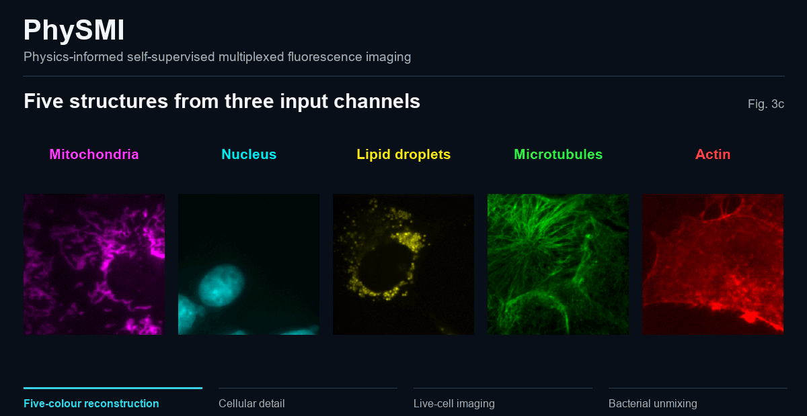

# PhySMI

Physics-informed self-supervised multiplexed fluorescence imaging.



Selected results from Figs. 3, 4 and 6 of the paper.

Paper author and code developer: **J. Xia ([@Yisher](https://github.com/Yisher))**.

PhySMI combines spectral reconstruction, a shared cellular-image prior and cross-branch denoising. The implementation and pretrained models are in [shared_models](shared_models/).

| Model | Application | Input channels | Output components |
|---|---|---:|---:|
| `static` | Fig4 and crosstalk | 3 | 5 |
| `cells` | External NIH-3T3 five-organelle images | 3 integrated emission bands | 5 |
| `ecoli` | External 13-dye E. coli images | 5 integrated emission bands | 13 |

Each model uses its matching response matrix in `shared_models/configs`. The fixed-cell model includes the updated signal-conditioned readout and requires no staining-panel list.

## Installation

Use Python 3.11 or later. From the repository root:

```sh
python -m pip install -r shared_models/requirements.txt
```

Install the PyTorch build appropriate for your CPU or CUDA device.

## Try the supplied data

[TestDATA](TestDATA/) contains fixed-cell examples and external cell and bacterial observations, all supplied as TIFF files. The laboratory and NIH-3T3 files have three input channels; E. coli has five. These files contain inputs only. Outputs are generated by inference.

Run one fixed-cell example:

```sh
python shared_models/infer.py --model static --input TestDATA/fixed_cells/COS7_Microscope1.tif --mode raw --output outputs/fixed_cell.tif --device cpu
```

List the examples or run the complete collection:

```sh
python shared_models/run_examples.py --list
python shared_models/run_examples.py --output outputs/test_data --device cpu
```

To run one application, add `--model static`, `--model cells` or `--model ecoli`. Use `--device cuda:0` for CUDA.

The example settings in [TestDATA/examples.json](TestDATA/examples.json) specify the matching model, input units and inference settings. [TestDATA/README.md](TestDATA/README.md) describes the data and external-source attribution.

## Your own images

`infer.py` accepts TIFF or NPY arrays with `C,Y,X` or `T,C,Y,X` axes. For laboratory data, the three input channels must be ordered **561, 532, 488 nm**. Use `--mode raw` for acquisition-unit inputs; the model configuration supplies background offsets and the input scale. Use `--mode normalized` only for inputs that have already undergone this preparation.

The external-cell and E. coli configurations define the emission bins integrated into each input band. Already integrated inputs are divided by the configured scale without being integrated again.

Predictions are float32 TIFF or NPY arrays. The accompanying JSON identifies component order and units. Inference applies no display contrast or spatial post-filter.

See [shared_models/README.md](shared_models/README.md) for tiling options, self-supervised training and interface tests.

## Reproduce Table 1

The [Table 1 reproduction package](table1/) provides the matched ablation configurations, training and evaluation code, original data assignments, full single-stain library, and corresponding checkpoints. Large numerical files are distributed through the linked release.

## Train the Fig. 6 models

The [Fig. 6 training workflow](fig6/) includes the single-stain texture sources, fixed simulation settings and source assignments, measured response and noise models, complete cell and E. coli training recipes, validation, and inference. Both workflows start from random initialization and use observation-based self-supervision without component-map targets.

## Acknowledgements

The spectral-attention backbone builds on [MST++](https://github.com/caiyuanhao1998/MST-plus-plus). External data sources and their licences are listed with the test data.
